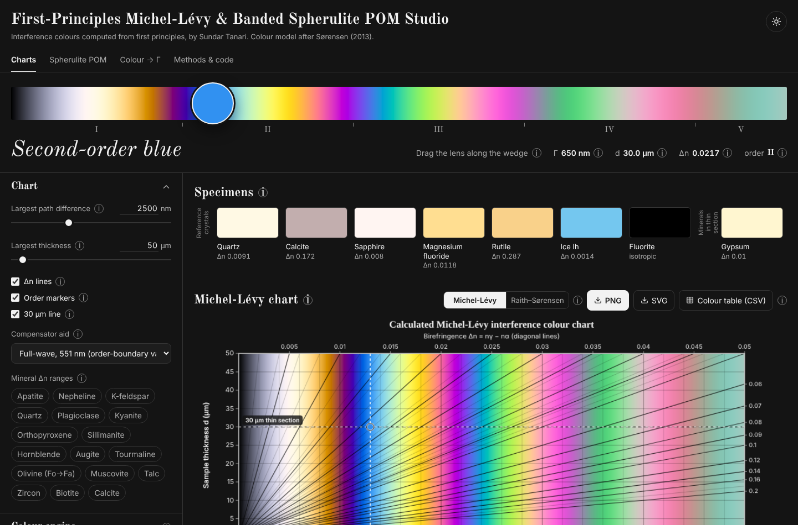
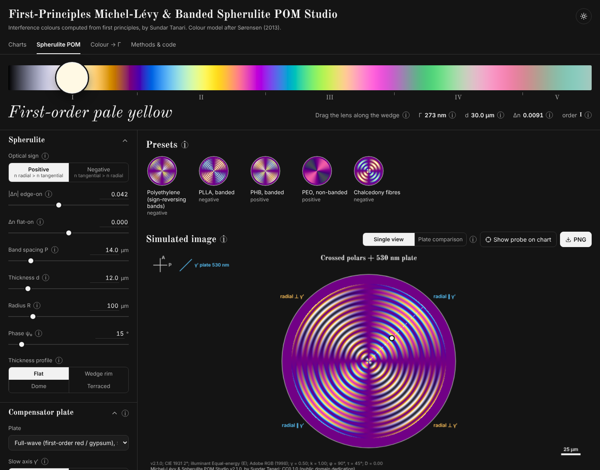

<div align="center">

# First-Principles Michel-Lévy & Banded Spherulite POM Studio

**Interference colours in polarised-light microscopy, computed from spectra, not painted.**

[](https://YOURUSERNAME.github.io/POM-studio-by-sundar/pom_studio_by_sundar.html)

[](https://creativecommons.org/publicdomain/zero/1.0/)


Designed, developed and maintained by **Sundar Tanari**

</div>



## What is this?

A free, interactive tool for anyone who works with **polarised-light microscopy (POM)**: students learning optical mineralogy, petrographers, crystallographers and polymer scientists studying banded spherulites.

Every colour you see is calculated from the physics, following [Sørensen (2013)](https://doi.org/10.1127/0935-1221/2013/0025-2252): the spectrum transmitted between crossed polars, weighted by the light source and the CIE 1931 colour-matching functions, then converted to screen colour. Because the colours are computed, they can be redrawn for any lamp, camera, compensator plate, thickness or crystal.

**It runs in your browser. There is nothing to install, no account, and nothing is uploaded: micrographs you load stay on your device.**

## Try it in 30 seconds

1. **Open the tool** (button above).
2. **Drag the lens** along the crystal wedge at the top. The colour's name, path difference, birefringence and interference order update as you move.
3. **Click a specimen**, such as quartz, calcite or olivine, to see where it sits on the chart.
4. **Click any small `i` button** for a plain-language explanation of that option.

## What you can do

| Tab | What it does |
|---|---|
| **Charts** | Calculated **Michel-Lévy** chart (colour against path difference and thickness) and **Raith–Sørensen** chart (colour against birefringence and thickness). Hover to read values, click to select, and see the colours you should observe with a compensator plate inserted. |
| **Spherulite POM** | Simulates a **banded spherulite** between crossed polars: optical sign, lamellar twist, thickness profile, and first-order red or quarter-wave plates, with a probe and radial profile. Compare plate orientations side by side. |
| **Colour → Γ** | Load a micrograph, click a grain, and get **ranked candidate path differences**. A second observation with the plate inserted resolves which interference order the colour belongs to. |
| **Methods & code** | The equations, limitations and citation, plus **Python and MATLAB scripts** that reproduce your figures offline. |



### Specimen library

Reference examples with well-established optical constants:

- **Reference crystals:** quartz, calcite, sapphire, magnesium fluoride, rutile, ice, fluorite (isotropic)
- **Minerals in thin section:** gypsum, olivine, muscovite, zircon
- **Compensator plates:** first-order red (551 nm) and quarter-wave (147 nm)

Values are nominal handbook figures near 589 nm. Natural minerals vary with composition, so check against your own reference for quantitative work.

### Spherulite presets

Polyethylene (sign-reversing bands), PLLA, PHB, PEO and chalcedony fibres. These are **illustrative starting points**; real birefringence and thickness depend on your material and how it crystallised.

### Exports

PNG (1–4×), SVG (editable vector), and a CSV colour table. Every figure carries its engine settings and a credit line, and these are also stored inside the file, so any figure can be reproduced.

## How it works

For each wavelength λ from 360 to 830 nm, the light transmitted through polariser, crystal and analyser is

```
L = cos²φ − sin 2(τ − φ) · sin 2τ · sin²(πΓ/λ)        (Bloss 1999)
```

which for crossed polars with the crystal at 45° reduces to `L = sin²(πΓ/λ)`, where the path difference is `Γ = 1000 · d · Δn` (Γ in nm, thickness d in µm).

The spectrum is weighted by the light source and the CIE 1931 colour-matching functions to give XYZ, converted to RGB, clipped to the range 0 to 1, and gamma-encoded.

With a compensator plate (retardation Γp, slow axis at 45°) and a crystal slow axis at angle α, the crossed-polar transmission is exactly

```
T = (1 − u²) sin²(πΓp/λ) + ½u(u + 1) sin²(π(Γp + Γ)/λ) + ½u(u − 1) sin²(π(Γp − Γ)/λ),   u = sin 2α
```

In a spherulite the slow axis is radial or tangential, so `u = ±sin 2θ` at azimuth θ. Three spectra per radius therefore give the whole image, including the dark or tinted cross. Banding is modelled as lamellae twisting about the radius: `Δn(r) = s · [Δn_edge · sin²ψ + Δn_flat · cos²ψ]`, with `ψ = πr/P + ψ₀`.

## Limitations

- Absorption and pleochroism (for example biotite and tourmaline) are not modelled; real colours are darker or tinted.
- Compensator plates are treated as dispersion-free.
- Spherulites are idealised: radially symmetric, with fibrils in the section plane, and no tilt or overlap.
- Screens differ. The colours are exact only on a calibrated display.
- This is a teaching and interpretation aid, not a substitute for a calibrated Berek or Sénarmont compensator when retardation must be measured quantitatively.

## Run it yourself

The whole tool is a single file, [`pom_studio_by_sundar.html`](pom_studio_by_sundar.html). Download it and double-click to open it in any modern browser; it works offline, apart from loading the heading typeface, for which it falls back to a system serif.

## Cite

If this tool helps your work, a citation is appreciated (it is not required):

> Tanari, S. (2026). *First-Principles Michel-Lévy & Banded Spherulite POM Studio* (Version 2.1.0) [Software].

Please also cite the colour model:

> Sørensen, B.E. (2013). A revised Michel-Lévy interference colour chart based on first-principles calculations. *Eur. J. Mineral.* 25, 5–10. https://doi.org/10.1127/0935-1221/2013/0025-2252

## Licence

This tool and everything it generates (charts, images, tables and scripts) are dedicated to the public domain under [**CC0 1.0 Universal**](LICENSE). Use, copy, adapt and publish them for any purpose, including commercial use, without asking permission.

Bundled third-party software keeps its own permissive licence: [Preact](https://preactjs.com) (MIT) and [lucide](https://lucide.dev) icons (ISC). Their notices are included at the end of the HTML file. The *Old Standard TT* heading typeface is under the SIL Open Font License and is loaded from Google Fonts.
